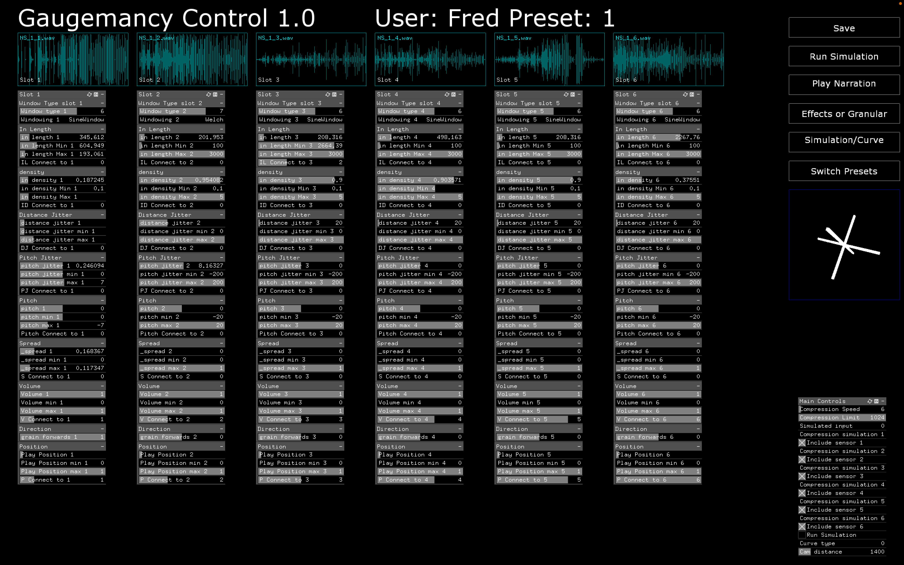
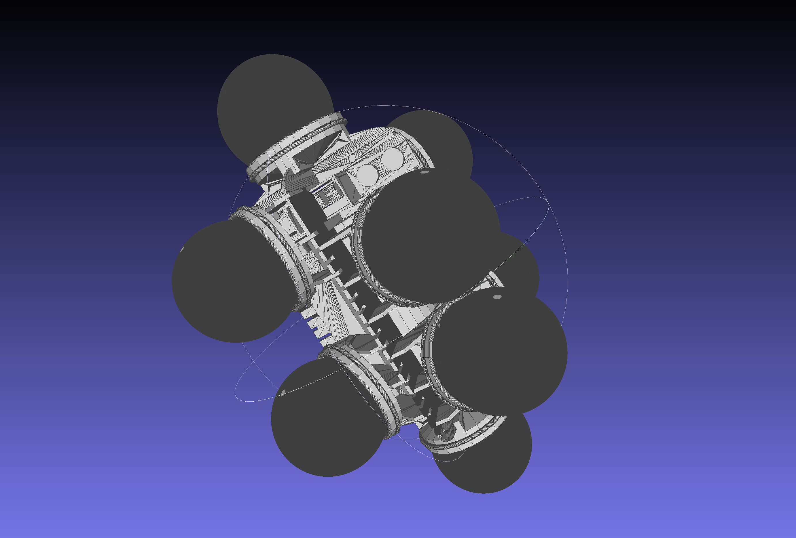

# Gaugemancy




A Raspberry Pi based granular instrument: ten small inflatable balls on an
upright body, six of them with pressure sensors, plus an accelerometer. Each
squeeze and tilt drives granular synthesis and effect chains. Made for the
project *Gaugemancy* with choreographer Ali Moini
(https://latitudescontemporaines.com/en/latitudes-prod/gaugemancy/) and
Pouya Ehsaei (https://www.pouyaehsaei.com/).

The same program is:

* **the instrument** on the Raspberry Pi (`--headless`, no window),
* **the programming tool** on macOS, Windows and Linux: choose which sensor
  drives which sound parameter and how, build effect chains, edit presets,
  simulate the instrument in 3D, and save everything as JSON.

> The interface screenshot above is of the old version; the new window is
> described below.

## Requirements

* openFrameworks `main` (git), built as usual for your platform
* addons:
  * [fred-dev/ofxPDSP](https://github.com/fred-dev/ofxPDSP) (audio engine), on its `ai-refactor` branch
  * [fred-dev/ofxAudioFile](https://github.com/fred-dev/ofxAudioFile) (sample loading), on its `ai-refactor` branch
  * [fred-dev/ofxGPIO](https://github.com/fred-dev/ofxGPIO) (Pi GPIO, SPI, I2C; stubs elsewhere), on its `ai-refactor` branch
  * [danomatika/ofxMidi](https://github.com/danomatika/ofxMidi) (needed by ofxPDSP)
  * [jvcleave/ofxImGui](https://github.com/jvcleave/ofxImGui) (the programming GUI), on its `develop` branch
  * ofxOsc (bundled with openFrameworks)

One `addons.make` works on every platform. The `ai-refactor` branch name
above is specific to those three addon forks - unrelated to Gaugemancy's
own branches below.

## Build

```bash
cd openFrameworks/apps/myApps
git clone https://github.com/fred-dev/Gaugemancy.git
cd Gaugemancy
make -j4 Release            # Linux, Raspberry Pi, macOS (command line)
make -C tests               # unit tests (no openFrameworks needed)
python3 tools/make_test_data.py
bin/Gaugemancy --profile Demo
```

`main` is the default, up-to-date branch; no `-b` flag is needed above.
(The old pre-rewrite codebase is kept as `legacy_version`, for reference
only.)

On Windows (Visual Studio), create the project files with the openFrameworks
project generator. The bundled `Gaugemancy.xcodeproj` is kept up to date for
macOS. The Raspberry Pi setup, wiring, service and SSH workflow are in
**[docs/RaspberryPi.md](docs/RaspberryPi.md)**.

## Settings

All settings are JSON, one folder per performer ("profile"):

```
bin/data/gaugemancy.json            {"activeProfile": "Fred"}
bin/data/Fred/profile.json          sensors, motion, audio device, narration,
                                    gestures, Pi hardware pins, OSC
bin/data/Fred/presets/preset_1.json six slots: sample, grain window, voices,
                                    grain parameters, effect chain; master chain
bin/data/Fred/audio/                the samples
```

On the Pi the folder is `/media/Data` (a USB stick) when it contains a
`gaugemancy.json`. Any value can be fixed or driven by a modulation source:
`sensor1`..`sensor6`, `total` (all balls), `tiltX`, `tiltY`, `tilt`, `shake`,
with its own `min`/`max` (swap them to invert). Old XML settings convert with
`python3 tools/convert_xml_settings.py bin/data`.

## The programming window

* **Transport**: presets, save, reload, sensor input (simulation or
  hardware), recording sensor performances to CSV.
* **Slots**: six waveforms with live grains; click and drag in one to audition
  it. Drop an audio file on a slot to load it (it is copied into the profile).
* **Editor**: the selected slot (sample, window, voices, when it is heard,
  every grain parameter with its sensor mapping, the effect chain: add, remove,
  reorder, enable), the master chain, or the narration.
* **Profile**: sensors and response curve, motion (accelerometer reference,
  range, smoothing, shake), hit gesture, audio device, Pi pins, OSC.
* **3D instrument**: hold a numbered ball to squeeze it, drag to tilt (drives
  the simulated accelerometer), double-click for level.

Function keys: F1-F6 select a slot, F7 master, F8 narration, F9 squeeze ramp,
F11 fullscreen, F12 save everything.

## Effects

Bit crusher, decimator, ladder filter, dimension chorus, stereo delay, reverb,
compressor and gain, in any order and combination, per slot, on the master
output and on the narration. Disabled effects cost no CPU. Reverb is the
heaviest: on a Pi prefer one reverb on the master chain over six slot reverbs.

## Testing without the instrument

```bash
bin/Gaugemancy --sensors sim                                    # GUI simulation
bin/Gaugemancy --sensors replay:bin/data/recordings/each_ball.csv
bin/Gaugemancy --record take1.csv                               # on the Pi
bin/Gaugemancy --selftest
bin/Gaugemancy --benchmark 20
tools/gm-ctl.py status | watch | next | squeeze 3 0.8 | tilt 20 0
```

## Code layout

```
src/core      settings + JSON, sensors, motion, smoothing, gestures, modes
              (no openFrameworks; unit tested in tests/)
src/audio     effects, effect chains, grain slots, narration, audio engine
src/hardware  sensor sources (ADC, accelerometer, replay, simulation), button/LEDs
src/app       Instrument (shared runtime), OSC remote control, diagnostics
src/gui       programming window, 3D instrument view
tools         XML converter, test data generator, gm-ctl
scripts       Pi install script and systemd service, remote.sh for SSH
```
